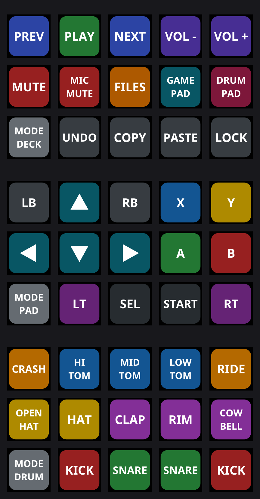

# deckpad

A small Stream Deck daemon for Linux, written in Rust, with three modes you
cycle through from the deck itself:

| Mode | What the deck becomes |
| --- | --- |
| **deck** | Classic macro pad: key combos, media keys, shell commands |
| **gamepad** | A virtual Xbox-style controller (uinput) |
| **drum** | A MIDI drum pad (ALSA sequencer port, General MIDI drum notes) |



It is a single ~2 MB binary with no GUI, no plugin host and no system
libraries to install: the HID backend is pure Rust and ALSA is loaded at
runtime, so it builds on immutable distros (Bazzite, Silverblue, SteamOS)
with nothing but `cargo`.

## Run

```sh
cargo run --release                 # start in the configured mode
cargo run --release -- -m drum      # start in a specific mode
cargo run --release -- --list       # show connected decks
cargo run --release -- --preview layouts.png   # render the layouts, no deck needed
```

Press the **MODE** key (bottom-left by default) to cycle deck → gamepad → drum.
Ctrl-C exits and returns the deck to its logo.

If the deck cannot be opened, install the udev rule in
[`contrib/70-deckpad.rules`](contrib/70-deckpad.rules). To start it at login,
see [`contrib/deckpad.service`](contrib/deckpad.service).

## Modes

**Gamepad.** The virtual pad uses the same button codes and USB IDs as an
Xbox 360 controller, so Steam, SDL and most games pick it up without setup.
Keys can be bound to buttons, the d-pad, triggers (full press) or stick
directions (full tilt); opposite directions cancel out. The controller is
created the first time you enter the mode and stays plugged in until exit.

**Drum.** Entering the mode creates a MIDI output port called `deckpad`.
It makes no sound by itself: connect it to a synth, sampler or DAW
(`aconnect -l` to list ports, `aconnect deckpad <target>` to wire it up, or
set `drum.connect` in the config to do that automatically). Notes are sent on
press and released on key-up, on channel 10 with a fixed velocity — the keys
are not pressure sensitive.

**Deck.** Each key sends a key combo (`keys = "ctrl+shift+t"`, any evdev key
name such as `volumeup` or `playpause`), runs a shell command, or jumps to a
mode.

## Configure

```sh
mkdir -p ~/.config/deckpad
cargo run --release -- --print-config > ~/.config/deckpad/config.toml
```

The file is commented; see [`config.default.toml`](config.default.toml).
Labels, colours, key positions, gamepad bindings, drum notes, MIDI channel
and velocity are all set there. Restart to apply changes.

## Supported devices

Any Stream Deck the driver knows (Original, MK.2, Mini, XL, Neo, Plus, Pedal
and compatible modules). Only the keys are used; dials and touch strips are
ignored. Developed and tested on a Stream Deck MK.2.

## Tests

```sh
cargo test                 # parsing and config
cargo test -- --ignored    # also creates a real virtual gamepad and MIDI port
                           # and reads the events back (needs uinput, ALSA, aseqdump)
```

## Built on

- [`elgato-streamdeck`](https://github.com/OpenActionAPI/rust-elgato-streamdeck)
  (MPL-2.0), the device driver behind [OpenDeck](https://github.com/nekename/OpenDeck).
  It is vendored in `vendor/elgato-streamdeck` with one change: `hidapi`'s
  default C backend is switched off so the build needs no libudev headers.
- [`evdev`](https://crates.io/crates/evdev) for the virtual gamepad and keyboard.

If you want a full Stream Deck app with a GUI and Elgato plugin support, use
OpenDeck. deckpad is for when you just want the deck to *be* a controller or
a drum pad.

License: MPL-2.0.
